# [PRD] 이마트 금정점 시니어 고객경험(CX) 혁신 프로젝트 보고용 웹페이지 개발 기획서
> **Product Requirements Document (웹 제품 요구사항 정의서)**  
> **프로젝트명:** 이마트 금정점 초고령 상권 맞춤형 시니어 CX 혁신 인터랙티브 보고용 웹페이지  
> **기반 문서:** [이마트_금정점_고객경험_개선_PRD.md](file:///c:/Users/qkrwn/Desktop/teamproject_emart_%EC%95%88%ED%8B%B0%EA%B7%B8%EB%9E%98%EB%B9%84%ED%8B%B0%EC%82%AC%EC%9A%A9/%EC%9D%B4%EB%A7%88%ED%8A%B8_%EA%B8%88%EC%A0%95%EC%A0%90_%EA%B3%A0%EA%B0%9D%EA%B2%BD%ED%97%98_%EA%B0%9C%EC%84%A0_PRD.md)  
> **신규 연계 자산:** [이마트 금정점 고령층 쇼핑 페르소나.png](file:///c:/Users/qkrwn/Desktop/teamproject_emart_%EC%95%88%ED%8B%B0%EA%B7%B8%EB%9E%98%EB%B9%84%ED%8B%B0%EC%82%AC%EC%9A%A9/%EC%9D%B4%EB%A7%88%ED%8A%B8%20%EA%B8%88%EC%A0%95%EC%A0%90%20%EA%B3%A0%EB%A0%B9%EC%B8%B5%20%EC%87%BC%ED%95%91%20%ED%8E%98%EB%A5%B4%EC%86%8C%EB%82%98.png)  
> **기술 스택:** 순수 바닐라 웹 기술 (HTML5 + Vanilla CSS3 + Vanilla JavaScript, **No-Database, No-Backend**)  
> **작성일자:** 2026년 10월 16일  
> **문서 버전:** v1.0 (최종 기획안)

---

## 1. 프로젝트 개요 (Executive Summary)

### 1.1 개발 목적 및 배경
- **개발 목적:**  
  본 웹페이지는 '퓨처앤드림아카데미 1차 고객경험 혁신 프로젝트'의 최종 성과물로서, 이마트 금정점의 초고령 상권 분석 데이터와 현장 관찰, 학술 연구 기반 솔루션(3-Step 매장안내도 + 시니어 특화 이지 스마트 카트)을 심사위원 및 이해관계자에게 가장 효과적으로 전달하기 위한 **대화형(Interactive) 프레젠테이션 & 보고용 단일 웹 애플리케이션(SPA)**을 구축하는 데 목적이 있다.
- **핵심 차별성:**  
  정적인 PDF나 종이 인쇄물의 한계를 극복하고, 발표자가 10분 발표 슬라이드로 즉시 활용할 수 있는 **[16:9 와이드 슬라이드 프레젠테이션 모드]**와 심사위원이 상세 데이터 및 인터랙션을 직접 체험할 수 있는 **[인터랙티브 대시보드 스크롤 모드]**의 '듀얼 뷰(Dual View)'를 제공한다.
- **신규 자산 통합:**  
  새로 추가된 고해상도 인포그래픽 이미지 자산인 `이마트 금정점 고령층 쇼핑 페르소나.png`를 웹페이지 내에 라이트박스(확대/축소 모달) 및 인터랙티브 카드 컴포넌트로 완벽히 통합하여 시니어 고객 김영숙(71세)의 페르소나와 6단계 고객여정지도를 생생하게 전달한다.

### 1.2 핵심 개발 원칙 (Technical Constraints)
1. **Zero Database (DB 미사용):**
   - 백엔드 데이터베이스 서버(MySQL, MongoDB 등)나 REST API 서버 없이 클라이언트 사이드에서 100% 자립적으로 동작.
   - 모든 통계 데이터, 페르소나 정보, 고객여정지표, 스마트카트 시뮬레이션 상태는 순수 JavaScript 내부 인메모리 객체(Object/Array)로 관리.
2. **Pure Vanilla Web Stack:**
   - Framework(React, Vue, Angular 등)나 번들러(Webpack, Vite 등) 설치 없이, `index.html` 파일을 브라우저에서 직접 더블클릭하거나 웹 서버에 배포하는 것만으로 즉시 구동되는 Vanilla JS 구조.
3. **독보적인 비주얼 심미성 (Premium Aesthetics):**
   - 이마트 시그니처 컬러(Yellow `#FFB800` & Deep Navy `#102A43`)를 기반으로 한 고품격 글래스모피즘(Glassmorphism)과 마이크로 인터랙션 적용.
   - 외부 무거운 라이브러리 없이 순수 CSS와 SVG를 활용한 감정곡선 인터랙티브 차트 구현.

---

## 2. 타겟 사용자 및 활용 시나리오 (Target Audience & Scenarios)

| 사용자 구분 | 주요 목표 | 웹페이지 내 핵심 활용 기능 |
|---|---|---|
| **팀 발표자 (Presenter)** | 10분 제한 시간 내 명확하고 몰입도 높은 최종 발표 수행 | • 16:9 슬라이드 모드 (키보드 좌우 화살표 네비게이션)<br>• 화면 우측 상단 10분 발표 타이머<br>• 전체화면(F11) 최적화 레이아웃 |
| **아카데미 심사위원 / 평가단** | 평가 기준(고객이해 30%, 참신성 25%, 실현가능성 25%, 완성도 10%, 전달력 10%) 검증 | • 페르소나 이미지 원본 고해상도 돋보기 뷰어<br>• As-Is vs To-Be 감정곡선 점수 인터랙티브 비교<br>• 팩트 기반 데이터(반경 500m 인구, 논문 회귀계수) 드릴다운 |
| **이마트 실무진 / 점포 기획자** | 현장 도입 타당성 및 리테일테크 솔루션 작동 메커니즘 확인 | • 3-Step 매장안내도 층별 시뮬레이션<br>• 이지 스마트 카트(Easy Cart) 대화형 터치스크린 시뮬레이터 (음성검색/바코드스캔/원스톱결제) |

---

## 3. 웹페이지 정보 구조도 (Information Architecture, IA)

웹페이지는 상단 네비게이션 바(GNB)를 통해 **[프레젠테이션 모드]**와 **[대시보드 모드]**를 자유롭게 전환할 수 있으며, 총 6개 핵심 테마와 16개 서브 섹션으로 구성된다.

```mermaid
graph TD
    Root[이마트 금정점 CX 개선 보고 웹페이지] --> GNB[상단 제어 바: 모드전환 / 발표타이머 / 전체화면 / 인쇄]
    
    Root --> Sec1[Section 1. Executive Summary]
    Sec1 --> S01[01. 프로젝트 타이틀 & 메인 비주얼]
    Sec1 --> S02[02. Executive Summary 인포그래픽]

    Root --> Sec2[Section 2. 상권 & 현장 분석]
    Sec2 --> S03[03. 초고령 상권 배경 & 점포 선정 근거]
    Sec2 --> S04[04. 반경 500m 빅데이터 분석]
    Sec2 --> S05[05. 10/14 현장 실사 관찰 기록]
    Sec2 --> S06[06. 학술 연구 논문 근거 실증 분석]

    Root --> Sec3[Section 3. 시니어 페르소나 & 문제정의]
    Sec3 --> S07[07. 신규 페르소나 김영숙 71세 & 공감캔버스]
    Sec3 --> S08[08. As-Is 6단계 고객여정지도 CJM]
    Sec3 --> S09[09. 진짜 문제정의 POV & 3대 HMW]

    Root --> Sec4[Section 4. 투트랙 혁신 솔루션]
    Sec4 --> S10[10. 솔루션 1: 3-Step 오프라인 매장안내도]
    Sec4 --> S11[11. 솔루션 2: 이지 스마트 카트 하드웨어 사양]
    Sec4 --> S12[12. 솔루션 2: 이지 스마트 카트 시니어 UI/UX 시뮬레이터]
    Sec4 --> S13[13. 솔루션 3: 이마트 사랑방 쉼터 & 골든 서포터즈]

    Root --> Sec5[Section 5. 개선 효과 & 비즈니스 임팩트]
    Sec5 --> S14[14. As-Is vs To-Be 감정곡선 인터랙티브 비교]
    Sec5 --> S15[15. 고객 & 비즈니스 정량적 기대효과]

    Root --> Sec6[Section 6. 실행 로드맵 & 맺음말]
    Sec6 --> S16[16. 3단계 파일럿 로드맵 & 리스크 관리]

    S07 -.-> Modal1[신규 이미지: 고해상도 페르소나 줌 뷰어 모달]
    S12 -.-> Sim1[이지카트 태블릿 터치 인터랙션 시뮬레이터]
```



---

## 4. 신규 이미지 자산(`이마트 금정점 고령층 쇼핑 페르소나.png`) 상세 연계 방안

신규 추가된 페르소나 인포그래픽 이미지는 본 프로젝트의 **‘고객이해(30%)’** 평가 항목을 증명하는 가장 핵심적인 시각 자산이다. 본 웹페이지에서는 이를 단순 삽입하는 데 그치지 않고 다음과 같이 3중으로 연계한다.

```
┌────────────────────────────────────────────────────────────────────────┐
│ [웹페이지 내 페르소나 섹션 배치 구조]                                  │
├───────────────────────────────────┬────────────────────────────────────┤
│ [좌측: 원본 인포그래픽 썸네일 카드]  │ [우측: 웹 인터랙티브 요약 패널]     │
│ ┌───────────────────────────────┐ │ 1. 김영숙(71세, 자립형 쇼핑객)     │
│ │  이마트 금정점 고령층          │ │    - 가상 대표 문장 음성/텍스트   │
│ │  쇼핑 페르소나.png             │ │ 2. 핵심 목표 & 가치               │
│ │  (100% 선명한 고화질 미리보기) │ │    - "남에게 의존 않고 내 손으로" │
│ │                               │ │ 3. 공감 캔버스 (Say/Think/Do/Feel)│
│ │  [ 🔍 원본 크게보기 (클릭) ]   │ │ 4. 6단계 여정 썸네일 탭          │
│ └───────────────────────────────┘ │    - 각 단계별 실사 사진 매핑      │
├───────────────────────────────────┴────────────────────────────────────┤
│ * '원본 크게보기' 클릭 시: 풀스크린 라이트박스 모달 실행 (확대/이동 기능 지원)│
└────────────────────────────────────────────────────────────────────────┘
```

1. **고해상도 라이트박스 뷰어 (Lightbox Modal):**
   - 페르소나 카드 클릭 시 화면 전체에 `이마트 금정점 고령층 쇼핑 페르소나.png` 원본 이미지가 부드러운 페이드인과 함께 확대 표시.
   - 마우스 휠을 통한 확대/축소(Zoom-in/out) 및 드래그 팬(Pan) 지원, ESC 키 또는 닫기 버튼으로 즉시 닫힘.
2. **컴포넌트 단위 인터랙티브 분해:**
   - 이미지 내 4대 핵심 영역(기본 프로필, 쇼핑 핵심 목표, 공감 캔버스, 6단계 고객여정)을 웹 UI 상에서 인터랙티브 탭/아코디언으로 재구성하여, 사용자가 직접 마우스를 올리거나 클릭할 때 세부 통계와 현장 사진이 하이라이트되도록 구현.

---

## 5. 상세 기능 요구사항 명세 (Functional Requirements)

### 5.1 [F-01] 듀얼 뷰 모드 제어 시스템 (Dual View Switcher)
- **설명:** 보고 발표용 슬라이드 모드와 정독 검토용 대시보드 모드를 원클릭으로 전환.
- **슬라이드 모드 (Presentation Mode - 기본값):**
  - 가로 세로 16:9 황금 비율 고정 캔버스.
  - 슬라이드 간 전환 애니메이션 (Slide Left/Right 또는 Smooth Fade).
  - 키보드 제어: `PageUp`, `PageDown`, `←`, `→`, `Spacebar`로 슬라이드 이동.
  - 하단 진행률 바(Progress Bar) 및 슬라이드 번호(예: `07 / 16`) 실시간 동기화.
- **대시보드 모드 (Continuous Scroll Mode):**
  - 전체 내용을 세로 스크롤 방식으로 한눈에 탐색할 수 있는 반응형 웹 리포트 뷰.
  - 좌측 플로팅 LNB(Local Navigation Bar)를 통해 클릭 시 해당 섹션으로 부드러운 스크롤(Smooth Scroll) 이동.

### 5.2 [F-02] 발표 지원 유틸리티 (Presenter Tools)
- **발표 타이머 (Presentation Timer):**
  - 화면 우측 상단에 10:00 카운트다운 타이머 탑재.
  - [시작 / 일시정지 / 리셋] 제어 가능.
  - 8분 경과 시 주황색 경고, 10분 초과 시 붉은색 점멸 알림.
- **전체화면 전환 (Fullscreen Toggle):**
  - `F11` 단축키 안내 및 UI 내 전체화면 토글 버튼 제공 (HTML5 Fullscreen API 연동).
- **인쇄 및 PDF 내보내기 최적화:**
  - `@media print` 스타일시트를 내장하여, 브라우저 인쇄(`Ctrl + P`) 시 슬라이드별 페이지 나눔(`page-break-after: always`)이 정확히 적용된 16:9 와이드 PDF 출력 지원.

### 5.3 [F-03] 데이터 시각화 & 학술 근거 인터랙션
- **상권 빅데이터 인포그래픽:**
  - 반경 500m 고령 인구 비율(60대 이상 36.0%, 50대 이상 57.0%) 및 의료복지시설(78개소) 데이터 카드.
  - 순수 CSS/SVG 기반의 애니메이션 게이지 및 바 차트 (페이지 진입 시 부드럽게 채워지는 효과).
- **학술 연구 회귀계수 인터랙티브 카드:**
  - 이진명 외(2021) 논문의 서비스품질 5대 차원 회귀분석 계수(물리적 환경 β=.283 만족도 1위, 편의적 혜택 β=.378 노인지향성 1위) 시각화.
  - 각 항목에 마우스 호버 시 실제 시니어 FGI 인터뷰 발언 툴팁 팝업.

### 5.4 [F-04] As-Is vs To-Be 감정곡선 인터랙티브 차트
- **설명:** 6단계 쇼핑 여정(방문준비 ➔ 입장 ➔ 상품탐색 ➔ 가격비교 ➔ 계산 ➔ 귀가)에 따른 감정 점수 변화를 SVG 라인 차트로 표현.
- **인터랙션:**
  - `[As-Is 기존 여정 보기]`, `[To-Be 혁신 여정 보기]`, `[동시 비교 보기]` 라디오/토글 버튼.
  - 각 여정의 포인트 점(Dot)을 클릭하거나 호버하면 고객의 구체적 Pain Point와 Delight Point가 팝업 카드로 노출.
  - 감정 점수 드라마틱 변화: 기존 평균 2.1점 ➔ 개선 후 4.6점으로 급상승하는 시각적 갭 하이라이트.

### 5.5 [F-05] 시니어 특화 '이지 스마트 카트(Easy Cart)' 인터랙티브 시뮬레이터
- **설명:** 보고서 내에서 가장 참신성이 높은 '이지 스마트 카트'의 10.1인치 태블릿 실제 동작 화면을 직접 조작해볼 수 있는 웹 시뮬레이터.
- **구현 기능:**
  1. **음성 검색 시뮬레이션:**
     - `[🎙️ 음성 검색 버튼]` 클릭 ➔ *"참기름 어디 있노?"* 가상 음성 발화 텍스트 출력 ➔ 매장 지도 상에 현재 위치에서 '1층 7번 매대'로 이어지는 초록색 경로 화살표 애니메이션 표시.
  2. **바코드 스캔 & 장바구니 담기 시뮬레이션:**
     - 매대 샘플 상품(`진한 참기름 6,900원`, `파머스픽 사과 9,900원`) 클릭 ➔ '삐-' 효과음 텍스트와 함께 카트 장바구니 리스트에 즉시 추가, 합산 금액 및 할인 금액 실시간 갱신.
  3. **카트 원스톱 결제 시뮬레이션:**
     - `[💳 카트에서 바로 결제]` 버튼 클릭 ➔ 신용카드 투입 애니메이션 ➔ "결제가 정상 완료되었습니다. 영수증이 발행됩니다" 완료 모달 및 출구 게이트 열림 시각화.

### 5.6 [F-06] 3-Step 매장안내 시스템 인터랙티브 가이드
- 다이소 홈플러스 동래점의 우수 사례 벤치마킹을 접목한 3단계 안내 체계 탭 전환:
  - **1단계 입구:** A5 접이식 포켓 리플릿 맵 목업 뷰 (가나다순 품목 인덱스)
  - **2단계 기둥:** 아이레벨(130~170cm) 4면 입체 기둥 인덱스 3D 회전 카드
  - **3단계 바닥:** 바닥 미끄럼 방지 컬러 유도선(초록/주황/파랑) 동선 시각화

---

## 6. 슬라이드별 상세 콘텐츠 구성 (16 슬라이드 아젠다)

| 슬라이드 번호 | 카테고리 | 슬라이드 제목 | 핵심 수록 콘텐츠 및 인터랙션 요소 |
|:---:|---|---|---|
| **01** | Cover | 이마트 금정점 시니어 고객경험(CX) 혁신 | 프로젝트 슬로건, 팀명, 대상 점포, 16:9 비주얼 배경, 시작하기 버튼 |
| **02** | Executive Summary | 초고령 상권 맞춤형 옴니채널 CX 혁신 개요 | 문제 정의 ➔ 투트랙 솔루션 ➔ 기대효과 3단계 핵심 인포그래픽 요약 |
| **03** | Data Research | 부산 금정구 인구 분석 & 점포 선정 배경 | 구서동/부곡동/남산동 고령인구 통계(27~32%), 초고령 주거벨트 특성 |
| **04** | Data Research | 반경 500m 상권 빅데이터 분석 | 60대 이상 유동인구 36%, 50대 이상 57%, 의료복지시설 78개소 집중도 |
| **05** | Field Research | 이마트 금정점 현장 실사 관찰 (10/14) | 안내도 전무, 셀프 18대 vs 유인 3대 병목, 높은 천장 표지판 실사 사진 |
| **06** | Academic Insight | 학술 연구 기반 실증 분석 (이진명 외, 2021) | 물리적 환경(β=.283 만족도 1위), 편의적 혜택(β=.378 노인지향성 1위), 시니어 인터뷰 |
| **07** | Target Persona | 타겟 페르소나: 자립형 시니어 김영숙(71세) | **`이마트 금정점 고령층 쇼핑 페르소나.png` 연동**, 공감캔버스 인터랙티브 뷰 |
| **08** | Customer Journey | As-Is 고객여정지도 (Customer Journey Map) | 6단계 터치포인트, 행동, 페인포인트, 감정 점수 딥다운(1.8점 최저점) |
| **09** | Problem Framing | 진짜 문제정의 (POV) & 핵심 질문 (HMW) | 자립형 시니어의 자율성을 가로막는 병목 규명, 3대 HMW 핵심 프레임 |
| **10** | Solution 1 | 3-Step 시니어 친화 매장 안내 시스템 | ①입구 포켓 리플릿 + ②아이레벨 기둥 인덱스 + ③바닥 유도선 시뮬레이션 |
| **11** | Solution 2 (HW) | 시니어 특화 '이지 스마트 카트' 하드웨어 사양 | 경량 프레임, 전동 모터 어시스트, 10.1인치 태블릿, 바코드/무게센서, 데드맨 안전 브레이크 |
| **12** | Solution 2 (UX) | 이지 스마트 카트 UI/UX 시뮬레이터 | **대화형 태블릿 목업:** 큰글씨 모드, 음성 검색 길찾기, 카트 즉시 결제 체험 |
| **13** | Solution 3 | 공간 & 인적 인프라 확충 (Care) | 1, 2층 '이마트 사랑방' 쉼터 벤치 + 시니어클럽 연계 '골든 서포터즈' 상시 배치 |
| **14** | Impact Analysis | As-Is vs To-Be 감정곡선 인터랙티브 비교 | 6단계 감정 점수 드라마틱 개선(2.1점 ➔ 4.6점), 단계별 Delight 포인트 비교 |
| **15** | Business Impact | 정량적·정성적 기대 효과 (Value Proposition) | 탐색 소요시간 40% 단축, 계산대 회전율 35% 향상, 시니어 락인 및 매출 증대 |
| **16** | Roadmap & Q&A | 파일럿 실행 로드맵 & 잠재 리스크 대응 | 단기(안내도/쉼터) ➔ 중기(카트20대 시범) ➔ 장기(권역 확대), 비용/안전 리스크 대응 |

---

## 7. 비기능적 요구사항 (Non-Functional Requirements)

1. **단일 파일 / 모듈 구동성 (Portability):**
   - 별도의 웹 서버 구동 없이도 로컬 파일 시스템(`file:///.../index.html`)에서 모든 기능이 완벽히 작동하도록 상대 경로 기반 자산 참조 구현.
   - 단, 최신 브라우저 보안 정책 상 모듈이나 이미지 로딩 최적화를 위해 간이 로컬 서버(VSCode Live Server 등)에서도 100% 호환되도록 구성.
2. **반응형 16:9 화면 고정 알고리즘:**
   - 다양한 모니터 해상도(FHD 1920x1080, QHD 2560x1440, 노트북 1366x768 등)에서 레터박스(Letterbox) 비율을 자동 계산하여 내용 왜곡 없이 선명하게 중앙 정렬되는 CSS `aspect-ratio: 16/9` 및 `transform: scale()` 반응형 뷰포트 지원.
3. **접근성 및 고대비 테마:**
   - 고령자 친화 프로젝트의 철학에 부합하도록 WCAG 2.1 AA 기준 준수 (명도 대비 최소 4.5:1 이상, 본문 폰트 16px 이상, 버튼 터치 타겟 최소 44x44px 확보).
4. **로딩 속도 및 성능:**
   - 번들 파일 용량 최소화, CSS 애니메이션 하드웨어 가속(`transform`, `opacity` 활용), 이미지 지연 로딩(Lazy Loading) 및 메모리 누수 방지.

---

## 8. 파일 시스템 구조 및 소스코드 구성안

프로젝트 폴더 내 보고용 웹페이지 관련 파일은 다음과 같이 직관적이고 깔끔하게 구성한다.

```
c:\Users\qkrwn\Desktop\teamproject_emart_안티그래비티사용\
├── index.html                                      # 메인 웹페이지 (HTML5 구조 및 시맨틱 마크업)
├── css/
│   ├── style.css                                   # 메인 디자인 시스템 (변수, 레이아웃, 글래스모피즘)
│   ├── presentation.css                            # 16:9 슬라이드 모드 및 화면 전환 애니메이션
│   └── simulator.css                               # 이지 스마트 카트 태블릿 시뮬레이터 전용 스타일
├── js/
│   ├── app.js                                      # 메인 컨트롤러 (모드 전환, 타이머, 키보드 이벤트)
│   ├── data.js                                     # 인메모리 데이터 (상권 통계, 페르소나, CJM, 회귀계수)
│   ├── persona-viewer.js                           # 페르소나 PNG 고화질 라이트박스 뷰어 로직
│   └── cart-simulator.js                           # 이지 스마트 카트 음성검색/스캔/결제 인터랙션 로직
├── 이마트 금정점 고령층 쇼핑 페르소나.png              # 핵심 페르소나 인포그래픽 자산 (연계 활용)
├── 이마트_금정점_고객경험_개선_PRD.md                # 기존 기획서 원본
└── 이마트_금정점_CX개선_보고용_웹페이지_PRD.md        # [본 문서] 웹페이지 개발 전용 PRD
```

---

## 9. 구현 및 검증 로드맵 (Action Items)

1. **1단계: 개발 기획서 확정 및 환경 검토 (완료)**
   - 본 PRD(`이마트_금정점_CX개선_보고용_웹페이지_PRD.md`) 작성 및 승인.
2. **2단계: 데이터셋 및 마크업 구조 설계 (Next Step)**
   - `data.js` 구축: 금정구 인구 통계, 10/14 관찰 데이터, CJM 6단계 데이터 객체화.
   - `index.html` 시맨틱 16개 슬라이드 및 듀얼 뷰 템플릿 작성.
3. **3단계: 프리미엄 비주얼 CSS 디자인 시스템 구축**
   - 이마트 옐로우/네이비 기반 색상 변수, 16:9 화면 고정 비율 스케일링, 인쇄 미디어 쿼리 구현.
4. **4단계: 핵심 인터랙션 개발 (Vanilla JS)**
   - 슬라이드 네비게이션 & 발표 타이머.
   - `이마트 금정점 고령층 쇼핑 페르소나.png` 원본 줌/팬 모달.
   - As-Is vs To-Be 감정곡선 인터랙티브 SVG 차트.
   - 이지 스마트 카트 실시간 터치 시뮬레이터.
5. **5단계: 브라우저 실사 검증 및 품질 최적화**
   - 크롬/엣지 브라우저에서 슬라이드 이동, 반응형 확대, 시뮬레이터 작동 및 인쇄 PDF 레이아웃 테스트.

---

> **기획 완료 승인:** 본 PRD는 데이터베이스 없이 순수 바닐라 자바스크립트로 최고 수준의 완성도와 심미성을 갖춘 보고용 웹페이지를 제작하기 위한 모든 요구사항과 기술 명세를 확정하였습니다.
