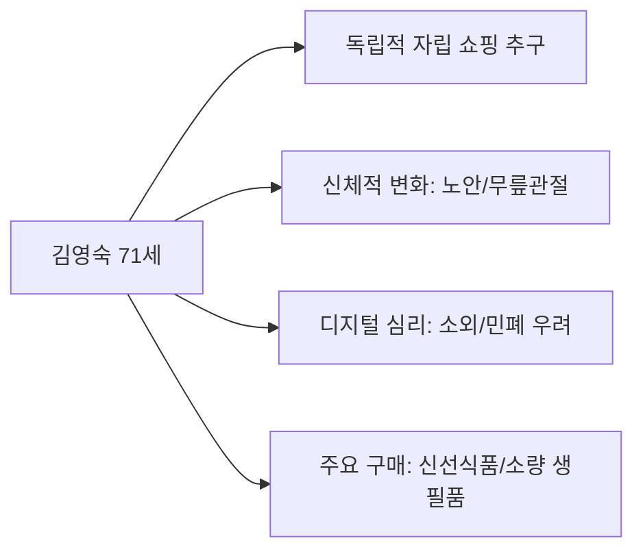
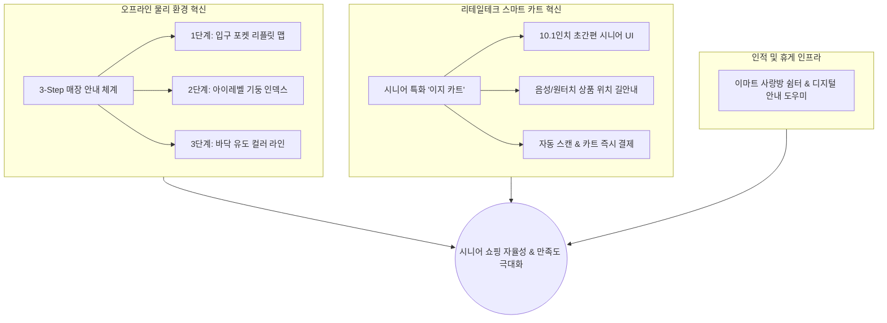
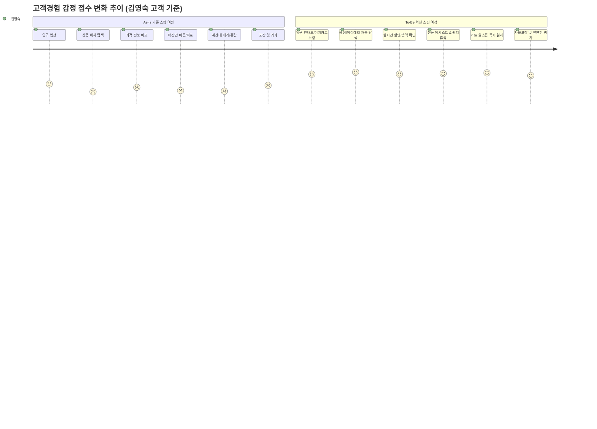

# [PRD] 이마트 금정점 시니어 고객경험(CX) 혁신 프로젝트
> **Product Requirements Document (제품/서비스 기획 요구사항 정의서)**  
> **부제:** 초고령 상권 맞춤형 ‘3-Step 매장안내 시스템’ 및 ‘시니어 프렌들리 이지 스마트 카트(Easy Cart)’ 도입 기획  
> **프로젝트 구분:** 퓨처앤드림아카데미 1차 팀 프로젝트 (고객경험 프로젝트)  
> **대상 점포:** 이마트 금정점 (부산광역시 금정구 중앙대로 1841번길 24)  
> **작성일자:** 2026년 10월 16일  
> **문서 버전:** v1.0 (최종 기획안)

---

## 1. 프로젝트 개요 (Executive Summary)

### 1.1 기획 배경
- **사회적 배경:** 대한민국은 65세 이상 인구가 20%를 넘어서는 초고령사회에 진입하였으며, 특히 부산광역시는 전국 광역시 중 가장 빠른 고령화 추세를 보이고 있음.
- **점포 특성:** 이마트 금정점 반경 500m 이내 주거인구 중 60대 이상 비율은 **35.3%**, 일평균 유동인구 중 60대 이상 비율은 **36.0%**(50대 이상 합산 시 **57.0%**)에 달해 전국 최고 수준의 시니어 밀집 상권에 위치함.
- **현장 실사 발견점 (2026.10.14 현장 방문):**
  - 실제 내점 고객의 대다수가 중장년 및 시니어층임에도 불구하고 매장 내 **안내도 부재, 복잡한 층별/구역 동선, 시선과 동떨어진 높은 천장형 안내판**으로 인해 심각한 상품 탐색 피로가 발생하고 있음.
  - 매장 1~2층에 총 18대의 스피드(셀프) 계산대가 설치되어 있으나, 유인 캐셔 계산대는 8대 중 단 3대만 가동되어 시니어 고객의 디지털 기기 조작 두려움 및 대기 지체 현상이 상존함.
- **프로젝트 핵심 과제:**
  - 시니어 고객이 타인에게 불필요하게 의존하지 않고 스스로 자율적이고 편안하게 장보기를 완료할 수 있도록, **[오프라인 매장 안내 시스템]**과 **[시니어 특화 스마트 카트(Easy Cart)]**를 융합한 옴니채널 고객경험 혁신 솔루션을 제안함.

### 1.2 아카데미 평가 기준 부합 전략

| 평가 항목 | 비중 | 본 PRD의 반영 전략 |
|---|:---:|---|
| **고객이해** | **30%** | 금정구 인구통계, 반경 500m/1,000m 소상공인 빅데이터, 현장 방문 실사 기록(10/14) 및 학술 연구(노인소비자 서비스품질 지각 논문)를 근거로 한 정밀한 시니어 페르소나와 As-Is 고객여정지도(CJM) 도출 |
| **참신성** | **25%** | 기존 대형마트의 일방향성 안내판을 탈피한 '3-Step 시각 인덱스 시스템'과 복잡한 IT 기능을 시니어 관점에서 극도로 단순화·최적화한 '이지 스마트 카트(Easy Cart)' UX 기획 |
| **실현가능성** | **25%** | 이마트 S-랩/LG전자 클로이 카트 연구 사례 및 글로벌 스마트카트(호주 Coles, 미 Instacart) 상용화 모델을 벤치마킹하여 기술적·운영적 비용 한계를 극복하는 단계별 파일럿 추진안 제시 |
| **내용완성도** | **10%** | 수치 데이터, 정성 인터뷰 인용, As-Is vs To-Be 감정곡선 비교, 기능 명세서, 화면 UI 목업 레이아웃, 최종 PDF 보고서 슬라이드 와이어프레임 완비 |
| **전달력** | **10%** | 10분 발표에 최적화된 16:9 와이드 슬라이드 스토리라인 및 핵심 메시지 구조화 |

---

## 2. 상권 및 현장 분석 (Data & Field Research)

### 2.1 행정동 주민등록 인구 분석 (부산 금정구 통계, 2025.07 기준)
- 이마트 금정점의 직접 영향권인 구서동, 부곡동, 남산동의 65세 이상 고령 인구 비율이 압도적으로 높음.
  - **구서2동:** 총인구 29,989명 중 65세 이상 **8,106명 (27.0%)**
  - **구서1동:** 총인구 18,235명 중 65세 이상 **4,520명 (24.8%)**
  - **부곡2동:** 총인구 16,422명 중 65세 이상 **4,368명 (26.6%)**
  - **부곡3동:** 총인구 14,271명 중 65세 이상 **3,867명 (27.1%)**
  - **남산동:** 총인구 25,407명 중 65세 이상 **8,231명 (32.4%)**
- **시사점:** 매장 배후 주거지의 4명 중 1명 이상이 65세 이상 시니어로 구성된 초고령 주거벨트 형성.

### 2.2 반경 500m 상권분석 빅데이터 (지역현황 및 인구 특성)
- **유동인구 분석:**
  - 일평균 유동인구 85,784명 중 **60대 이상 비율 36.0% (31,197명)로 전 연령대 중 1위**
  - 50대(21.0%)와 60대 이상을 합산하면 **57.0%**에 달함.
  - 주중(49.1%)과 주말(50.9%) 편차가 거의 없어 평일에도 시니어 쇼핑 유입이 상시 활발함.
  - 피크 시간대: 14~18시(24.8%), 18~23시(25.1%)
- **주거인구 및 가구 분석:**
  - 선택영역 주거인구 16,870명 중 60대 이상 **35.3% (5,956명)**, 여성 비율 52.7%
  - 세대수 7,402세대 중 아파트 거주 세대가 다수(5,763호), 66㎡(20평형대) 중심 거주.
- **소득 및 소비 수준:**
  - 구서1동 60대 이상 주거인구 소득은 월 277~321만 원, 소비는 월 141~163만 원 수준으로 월평균 4분위의 안정적인 장보기 지출력을 보유한 '액티브 시니어' 성향을 보임.
- **주변 인프라 특성:**
  - 반경 500m 내 **의료/복지 시설이 78개소** 집중 분포 (금정구 전체 복지/의료시설의 높은 비중 차지).
  - 부산 지하철 1호선 구서역(일평균 승하차 18,592명) 및 버스정류장 45개 인접으로 도보 및 대중교통 접근성이 우수함.

### 2.3 이마트 금정점 현장 실사 분석 (2026.10.14 수요일 17:40 방문 관찰)
1. **고객 프로필:** 평일 늦은 오후 시간대 방문 고객의 약 70% 이상이 50대 후반~70대 시니어 고객.
2. **진출입 동선:** 메인 입구, 후면 입구, 소형 출입구 등 최소 3개 이상의 진입로가 존재하나, **어느 출입구에도 전체 층별 구성이나 상품 카테고리를 안내하는 매장 안내도(Floor Map)가 전무함.**
3. **계산대 운영 현황:**
   - 1층: 캐셔 계산대 8대 중 실제 운영은 **단 3대**, 셀프계산대(스피드) 12대 운영.
   - 2층: 셀프계산대(스피드) 6대 운영.
   - 관찰 결과, 유인 계산대 3곳에만 긴 대기줄이 형성되어 있고, 시니어 고객들은 셀프계산대 앞에서 주저하거나 망설이는 행동이 빈번히 관찰됨.
4. **매장 내 시각물 및 안내 체계:**
   - 천장에 매달린 안내판은 글씨가 작고 보행자의 시선 각도보다 높아 노안이나 척추 굴곡이 있는 고령층이 고개를 들고 확인하기 어려움.
   - 5K 프라이스, 노브랜드, 피코크 등 다양한 PB 상품존과 행사 매대가 산재되어 있어 일반 상품과 PB 상품 간의 구획 파악이 혼란스러움.

---

## 3. 학술 연구 및 선행 레퍼런스 분석

### 3.1 학술 연구 시사점 (이진명 외, 2021, 소비자학연구)
> *「노인소비자의 대형마트 서비스품질 지각이 만족도 및 노인지향성 지각에 미치는 영향」*
- **서비스품질 5대 차원 실증 분석 결과:**
  1. **물리적 환경 (β = .283, p < .001):** 노인소비자의 대형마트 만족도에 가장 결정적인 1위 영향 요인. (상품 진열, 동선 설계, 안내표지 가시성, 카트 편의성)
  2. **편의적 혜택 (β = .378, p < .000):** 대형마트의 **‘노인지향성(Elderly Orientation - 노인을 배려하는 마트라는 인식)’ 지각에 가장 큰 정(+)의 영향**을 미침. (휴게공간 확충, 벤치 설치, 편의시설)
  3. **스마트 혜택 (β = .228, p < .000) & 인적 상호작용 (β = .169, p < .05):** 스마트 혜택은 만족도(β=.144)와 노인지향성(β=.228) 모두에 유의하나, 현재 노인들의 스마트 혜택 만족도는 4.22점으로 5대 요인 중 가장 낮음.
- **연구 내 실제 시니어 심층 인터뷰(FGI) 핵심 보이스:**
  - *"표지판은 있으나 '7번으로 가시오' 이게 끝이다. 몇 번째 칸 몇째 줄인지 정확하게 찾을 수 있으면 좋겠다."*
  - *"고개를 들어야 하는데 눈높이에서만 보니까 자주 헤맨다. 그냥 헤매다 직원한테 물어본다."*
  - *"무인계산기는 실수하면 어떡하나 두렵다. 은행 ATM처럼 큰 글씨면 좋겠다."*
  - *"나이 들면 마트에 오는 게 민폐가 아닌가 하는 생각도 든다. 우리를 위한 휴게공간/벤치가 필요하다."*

### 3.2 벤치마킹 사례 분석
1. **다이소 홈플러스 동래점 매장 안내도:**
   - 카테고리별 명확한 고대비 컬러 코딩(문구: 청색, 인테리어: 주황, 욕실: 녹색 등).
   - "현위치" 핀 표시 및 주요 통로 라인 가이드, 스마트폰 QR코드 연동 상품 검색 탑재.
2. **글로벌 스마트 카트 (호주 Coles, 미국 Instacart Caper Cart):**
   - 카트 내 디스플레이를 통한 실시간 바코드 스캔, 합산 금액 확인, 품목별 매장 위치 안내.
   - 단점 및 한계: 복잡한 인증 절차와 높은 초기 도입비(대당 $5,000~$10,000)는 시니어 친화적 전환 시 간소화가 필수적임.
3. **이마트 S-랩 & LG전자 클로이 스마트 카트:**
   - 자율주행 추종(팔로잉), 음성인식, 매장 안내 기능 연구 선행 사례 보유.

---

## 4. 타겟 페르소나 및 고객여정지도 (Persona & CJM)

### 4.1 타겟 페르소나 (Persona Profile)



- **이름 / 연령:** 김영숙 (가명, 71세, 여성)
- **거주지 / 생활:** 부산 금정구 구서동 거주 (부부 2인 가구, 은퇴 생활)
- **방문 특성:** 주 1~2회 도보 또는 마을버스로 이마트 금정점 방문, 1회 장보기 시간 약 45~60분
- **디지털 리터러시:** 스마트폰 카카오톡 및 전화 통화는 원활하나, 앱 카드 결제나 터치스크린 키오스크의 복잡한 계층 메뉴는 조작 실패 경험으로 인한 거부감 보유.
- **가상 대표 문장:** *“남한테 아쉬운 소리 안 하고, 내 눈으로 물건 싱싱한 거 골라서 마음 편하게 계산하고 오고 싶어요.”*
- **핵심 가치:** 자율성(스스로 해결), 정확성(할인/가격 오해 방지), 편안함(육체적 피로 최소화), 익숙함(직관적 절차).

### 4.2 공감 캔버스 (Empathy Map)

| 구분 | 시니어 고객의 경험 및 심리 상태 |
|---|---|
| **SAY (말)** | “양조간장이 어디 코너에 있더라?”, “셀프계산대는 뒤에 사람 기다릴까 봐 겁나서 못 서겠어.” |
| **THINK (생각)** | ‘직원들도 바빠 보이는데 자꾸 물어보면 귀찮아하겠지?’, ‘내가 기계를 잘못 눌러서 결제가 잘못되면 어쩌나.’ |
| **DO (행동)** | 입구에서 두리번거리다 익숙한 채소 코너부터 돔. 높은 진열대의 상품 위치를 확인하기 위해 통로를 서성임. 캐셔 계산대에 줄이 길어도 묵묵히 대기함. |
| **FEEL (감정)** | 매장 입장 시 기대감 → 탐색 실패 시 답답함과 신체적 피로 → 계산대 대기 시 초조함 → 장보기 완료 후 녹초가 됨. |
| **PAINS (고통)** | 넓은 매장을 왕복하는 다리 통증, 높은 천장 안내판의 가독성 불량, 셀프계산대에서의 소외감. |
| **NEEDS (요구)** | 내 눈높이에 맞는 명확한 위치 안내, 조작이 간편하고 글씨가 큰 쇼핑 보조 수단, 쇼핑 중간에 쉴 수 있는 공간. |

### 4.3 As-Is 고객여정지도 (Customer Journey Map)

| 단계 | 접점 (Touchpoint) | 고객 행동 | 고객의 Pain Point | 감정 점수 (1~5) | 개선 기회 (Opportunity) |
|---|---|---|---|:---:|---|
| **1. 방문·입장** | 입구, 카트 보관소 | 출입구로 진입 후 일반 철제 카트를 꺼냄 | 출입구에 매장 전체 배치도나 층별 안내도가 전혀 없음. 카트가 무겁고 뻑뻑함 | 3.0 | 입구 전면 리플릿 배치 및 경량/스마트 카트 대여 |
| **2. 상품 탐색** | 통로, 천장 표지판 | 메모해 둔 물품(참기름, 소면 등)을 찾기 위해 통로를 배회 | 천장 표지판은 올려다보기 힘들고 대분류만 적혀 있어 세부 매대를 못 찾고 되돌아감 | **1.8** | **눈높이(Eye-level) 인덱스 및 스마트 카트 위치 검색** |
| **3. 가격·품질 비교** | 상품 매대, 가격표 | 신선식품을 고르고 가격표 및 PB 상품 비교 | 작은 가격표 글씨, 1+1 및 다중 구매 조건 등 복잡한 POP 해석 곤란 | 2.5 | 대화면 카트에서 바코드 스캔 시 실시간 혜택가 표시 |
| **4. 이동·휴식** | 무빙워크, 코너 | 1층(식품)과 2층(생필품/패션)을 오가며 쇼핑 | 무거운 카트를 밀고 이동하며 무릎과 허리 통증 발생. 잠시 앉아 쉴 의자가 전혀 없음 | **2.0** | **중간 휴게 벤치 설치 및 전동 어시스트 카트** |
| **5. 계산·결제** | 계산대 (유인/셀프) | 유인 계산대로 향하나 3곳만 열려 대기줄 긺. 셀프계산대는 포기 | 셀프계산대 음성 안내가 빠르고 오류 화면 발생 시 당황. 유인 계산대 장시간 기립 대기 | **1.9** | **스마트 카트 원스톱 간편 결제 & 시니어 전담 도우미** |
| **6. 포장·귀가** | 자율포장대, 출구 | 종이박스에 테이프를 붙여 포장 후 이동 | 박스 테이프 끊기와 무거운 짐 운반 부담 | 2.8 | 자율포장대 작업 편의 개선 및 배송 연계 지원 |

---

## 5. 진짜 문제 정의 (Problem Definition: POV & HMW)

### 5.1 POV (Point of View)
> **"금정구에 거주하는 70대 자립형 시니어 고객 김영숙 씨는**  
> 신체적 피로와 노안에도 불구하고 누구에게도 의존하지 않고 스스로 필요한 식재료를 장보기 원하지만,  
> **[시선과 동떨어진 매장 안내 체계]와 [고령자를 배려하지 않은 디지털 전환(셀프계산대 중심 운영)]으로 인해**  
> 매장 안에서 길을 잃고 헤매며 디지털 소외감과 심리적 위축을 겪고 있다."

### 5.2 HMW (How Might We: 핵심 질문)
1. **[탐색]** 어떻게 하면 시니어 고객이 고개를 아프게 젖히거나 직원을 찾아 헤매지 않고도, **자신의 눈높이에서 원하는 상품의 정확한 위치를 10초 안에 직관적으로 파악**하게 할 수 있을까?
2. **[디지털/결제]** 어떻게 하면 시니어 고객이 복잡한 스마트폰 앱이나 키오스크 없이도, **카트 자체를 통해 상품을 담으면서 가격을 바로 확인하고 줄서지 않고 안심 결제**를 마치게 할 수 있을까?
3. **[체력/편의]** 어떻게 하면 넓은 매장(1~2층)을 이동하는 시니어의 **신체적 부담을 덜어주고, 쇼핑 중간에 편안하게 머무를 수 있는 노인지향적 매장 환경**을 조성할 수 있을까?

---

## 6. 제품 솔루션 상세 명세 (To-Be Solutions)

본 기획은 시니어 고객의 디지털 수용도 스펙트럼을 고려하여, **[오프라인 직관 안내 (Low-Tech)]**와 **[시니어 맞춤형 스마트 카트 (High-Tech)]**가 상호 보완하는 **‘투트랙 옴니채널 고객경험 모델’**을 구축한다.



---

### 6.1 솔루션 1: 3-Step 시니어 친화 매장 안내 시스템 (Store Guidance System)

다이소 홈플러스 동래점의 우수 사례를 대형마트 규모에 맞게 발전시켜, 시니어의 시야각(눈높이 120~150cm)과 보행 패턴에 맞춘 3단계 안내 체계를 구축함.

#### ① [1단계: 입구] '한눈에 쏙' 시니어 전용 포켓 리플릿 맵 및 스탠드 배치
- **설치 위치:** 이마트 금정점 주요 3대 출입구(메인/후면/소형) 및 카트 거치대 옆.
- **디자인 규격:**
  - 접었을 때 A5 크기, 펼쳤을 때 A3 규격의 가독성 높은 코팅 용지.
  - 18pt 이상의 나눔스퀘어라운드 고령자 친화 서체 적용.
  - **카테고리별 고대비 컬러 코딩:**
    - 🟢 청과/채소 (초록)
    - 🔴 정육/수산 (다홍)
    - 🟡 가공식품/조미료 (노랑)
    - 🔵 일상용품/세제 (파랑)
    - 🟣 2층 패션/가전/다이소 (보라)
- **콘텐츠 구성:**
  - 층별 핵심 상품군 위치 및 코너 번호 표기.
  - 가나다순 주요 생필품 인덱스 ("간장 -> 1층 7번 매대", "라면 -> 1층 4번 매대").
  - 글씨를 읽기 어려운 고객을 위한 픽토그램(그림 아이콘) 전면 병기.

#### ② [2단계: 이동 동선] 아이레벨(Eye-level) 기둥 인덱스 및 대형 코너 식별판
- **기존 문제 개선:** 천장에 높게 매달려 시니어 시야를 벗어난 사각지대 해소.
- **디자인 적용:**
  - 매장 내 주요 지주 기둥 높이 130~170cm 위치에 **'사면(4-Side) 입체 인덱스 랩핑'** 시공.
  - 통로 진입 시 어느 방향에서도 현재 매대의 대표 품목 3가지가 한눈에 보이도록 표기.
  - 주요 인기 코너(계란, 쌀, 두부, 정육, 우유)는 기둥 상단에 돌출형 조명 픽토그램 설치.

#### ③ [3단계: 바닥 동선] 바닥 컬러 웨이파인딩(Wayfinding) 가이드 라인
- 병원이나 지하철 환승역에서 고령자 길찾기 성공률을 70% 이상 향상시킨 컬러 유도 라인 벤치마킹.
- 바닥에 미끄럼 방지 처리된 컬러 라인 부착:
  - 초록색 라인: 신선식품 주요 동선
  - 주황색 라인: 가공/냉동식품 동선
  - 파란색 라인: 2층 무빙워크 및 계산대/출구 방향

---

### 6.2 솔루션 2: 시니어 특화 스마트 카트 '이지 카트 (Easy Cart)'

기존의 복잡한 스마트카트 기능 중 불필요한 군더더기를 제거하고, 시니어의 핵심 고통(위치 탐색, 계산대 대기, 카트 무게)을 해결하는 맞춤형 카트 도입.

```
┌─────────────────────────────────────────────────────────┐
│                 [이지 카트(Easy Cart) 태블릿 화면]         │
├─────────────────────────────────────────────────────────┤
│  [ 큰 글씨 모드 ]                          이마트 금정점 │
│                                                         │
│   🔍 "찾으시는 물건을 말씀하시거나 눌러주세요"           │
│   ┌─────────────────────────────────────────────────┐   │
│   │  🎙️ [마이크 터치 후 말하기] "참기름 어디 있노?"  │   │
│   └─────────────────────────────────────────────────┘   │
│                                                         │
│   [빠른 찾기 버튼]                                      │
│   [ 계란/우유 ]   [ 라면/통조림 ]   [ 화장지/세제 ]     │
│   [ 과일/채소 ]   [ 정육/생선 ]     [ 소금/간장/양념 ]   │
│                                                         │
├─────────────────────────────────────────────────────────┤
│  🛒 현재 담은 상품: 3개                 합계: 24,800원  │
│  - 진한 참기름 350ml (할인적용)             6,900원  [X]│
│  - 파머스픽 사과 1봉                        9,900원  [X]│
│  - CJ 햇반 8입                             8,000원  [X]│
├─────────────────────────────────────────────────────────┤
│  [ 📍 현재 위치에서 길찾기 ]      [ 💳 카트에서 바로 결제 ]│
└─────────────────────────────────────────────────────────┘
```

#### ① 하드웨어(HW) 사양
- **화면 디스플레이:** 10.1인치 광시야각 저반사 터치 디스플레이 (햇빛/조명 반사 방지).
- **무게 센서 & 비전 바코드 리더기:**
  - 카트 손잡이 바로 아래 바코드 리더기 내장 (상품을 카트에 넣기 전 가볍게 대기만 하면 '삐-' 소리와 함께 화면에 품목과 가격이 큼직하게 뜸).
  - 바구니 하단 로드셀(무게 센서)로 결제 누락 및 도난 방지 자동 검증.
- **파워 어시스트(전동 보조 구동):**
  - 손잡이에 압력 감지 센서 탑재. 카트를 밀 때 모터가 가볍게 힘을 보태주어 생수나 쌀 등 무거운 물건을 담아도 70대 어르신이 한 손으로 부드럽게 밀 수 있음.
- **비상 호출 벨(물리 버튼):**
  - 기기 조작이 어렵거나 문제가 생겼을 때 누르면 주변 상주 직원의 스마트워치로 위치 알림이 전송되는 물리 빨간 버튼 장착.

#### ② 소프트웨어(SW) & UX/UI 디자인
- **시니어 전용 초간단 UI (Simple Senior Mode):**
  - 로그인/회원가입 절차 생략 (원할 경우 신세계포인트 휴대폰 번호 입력만으로 자동 연동).
  - 글씨 크기 24pt 이상, 명도 대비 7:1 이상의 고대비 테마(노란색/남색 조합) 적용.
- **음성 인식 상품 검색 (Voice Search):**
  - 사투리 및 노인 발화 특성을 학습한 음성 엔진 탑재 ("된장이 어디 붙었노?", "밀가루 찾는다").
  - 음성 인식 즉시 매장 도면 위에 현재 카트 위치에서 해당 매대까지의 경로를 굵은 화살표로 직관적 안내.
- **카트 내 원스톱 즉시 결제 (Self-Checkout on Cart):**
  - 카트 우측에 신용카드/체크카드 IC 삽입기 및 삼성페이 접촉부 장착.
  - 쇼핑이 끝나면 계산대에 줄 설 필요 없이, 카트에서 '결제하기' 버튼을 누르고 카드를 꽂으면 즉시 영수증 출력(또는 모바일 영수증 전송) 후 전용 게이트를 통해 출차.

---

### 6.3 솔루션 3: 인적 상호작용 및 편의 시설 확충 (Human & Space Care)

학술 연구에서 도출된 **'편의적 혜택이 노인지향성에 미치는 결정적 영향(β=.378)'**을 적극 반영함.

1. **'이마트 금정 사랑방' 쇼핑 쉼터 조성:**
   - 1층 신선식품 코너 끝자락 및 2층 에스컬레이터 옆 공간에 푹신한 등받이 벤치와 혈압측정기, 정수기를 구비한 시니어 전용 쉼터 2개소 구축.
   - 쇼핑 도중 다리가 아픈 어르신들이 동행자와 함께 안심하고 휴식할 수 있는 환경 제공.
2. **'골든 서포터즈' (디지털 쇼핑 도우미) 상시 배치:**
   - 관찰된 문제인 '셀프계산대 18대 앞 주저 현상' 해소를 위해, 금정구 노인일자리 사업(시니어클럽)과 연계하여 시니어 디지털 서포터즈 4명을 피크시간대(14~18시) 집중 배치.
   - 또래 시니어가 친절하게 스마트 카트 사용법 및 셀프계산대 결제를 안내하여 심리적 문턱을 완벽히 제거.

---

## 7. To-Be 고객여정 및 개선 효과 (Impact Analysis)

### 7.1 As-Is vs To-Be 고객경험 여정 비교



| 여정 단계 | 기존 As-Is 경험 (Pain Points) | 개선 후 To-Be 경험 (Delight Points) | 감정 점수 변화 |
|---|---|---|:---:|
| **1. 입장/카트** | 안내도 없음, 무거운 철제 카트 씨름 | 입구에서 포켓 리플릿 맵 획득, 가볍게 밀리는 이지 스마트 카트 탑승 | **3.0 ➔ 4.5** (+1.5) |
| **2. 상품 탐색** | 높은 천장 표지판, 층간 헤맴, 직원 찾아 삼만리 | 카트 화면 음성 검색("미역 어디 있노?") ➔ 도면 경로 안내 + 기둥 눈높이 인덱스로 30초 내 발견 | **1.8 ➔ 4.8** (+3.0) |
| **3. 가격 비교** | 작은 가격표, 복잡한 행사조건 혼란 | 바코드 스캔 즉시 24pt 대형 글씨로 최종 결제가격 및 절약 금액 실시간 표시 | **2.5 ➔ 4.5** (+2.0) |
| **4. 이동/휴식** | 1~2층 왕복 보행 피로, 앉을 곳 없음 | 전동 모터 어시스트로 힘들이지 않고 이동, 중간 '이마트 사랑방'에서 잠시 휴식 | **2.0 ➔ 4.6** (+2.6) |
| **5. 계산/결제** | 3곳뿐인 유인계산대 장시간 대기, 셀프계산대 기피 | 카트에서 카드 꽂고 10초 만에 원스톱 결제 후 전용 통로 출차 | **1.9 ➔ 4.7** (+2.8) |
| **6. 포장/귀가** | 신체 방전 상태로 귀가 | 체력 소모 없이 가뿐하게 쇼핑 완료, "다음 주에 또 와야지" 자발적 재방문 의사 형성 | **2.8 ➔ 4.3** (+1.5) |

### 7.2 정량적·정성적 기대 효과

1. **고객 관점 (Customer Value):**
   - **쇼핑 소요 시간 및 불필요한 이동 거리 40% 단축:** 상품 탐색 헤맴 시간 평균 18분 ➔ 5분 미만 감소.
   - **신체적 피로도 대폭 완화:** 전동 어시스트 카트 및 휴게 쉼터 도입으로 관절/체력 부담 경감.
   - **디지털 자율성 및 성취감 고취:** 타인의 도움 없이도 스마트 기술을 통해 스스로 결제까지 완수하는 자존감 형성.
2. **매장 및 비즈니스 관점 (Business Value):**
   - **객단가 및 장바구니 규모 증대 (추정 +12%):** 실시간 장바구니 합산 금액 및 할인 프로모션 노출을 통한 계획 구매 촉진.
   - **계산대 병목 해소 및 운영 효율 극대화:** 카트 자체 결제 분산으로 유인 계산대 대기 시간 50% 단축, 셀프 계산대 회전율 35% 향상.
   - **시니어 락인(Lock-in) 및 지역 점유율 수호:** 인근 식자재마트 및 온라인 커머스(쿠팡/컬리)에 이탈하지 않는 '시니어 친화 1등 마트' 브랜드 이미지 확립.

---

## 8. 최종 산출물(PDF 보고서) 구성 사양

팀 프로젝트 최종 제출 및 발표를 위해 제작할 **PDF 보고서(16:9 와이드 프레젠테이션 포맷)**의 상세 슬라이드 구성안은 다음과 같다.

### 8.1 보고서 규격 및 톤앤매너
- **페이지 비율:** 16:9 와이드스크린 (발표 및 디지털 뷰어 최적화)
- **컬러 시스템:**
  - Primary: 이마트 시그니처 옐로우 (`#FFB800`) & 딥 네이비 (`#1A2B49`)
  - Accent: 신뢰를 주는 틸 그린 (`#008B7A`) & 경고/포인트 레드 (`#E63946`)
- **타이포그래피:** Pretendard / KoPubWorld 돋움 (가독성 최우선, 굵기 대비 명확화)

### 8.2 슬라이드별 상세 목차 (총 16 슬라이드 구조)

| 슬라이드 | 대주제 | 핵심 내용 및 시각 요소 |
|:---:|---|---|
| **01** | **타이틀** | 프로젝트 명칭, 슬로건, 팀명, 일자 (이마트 금정점 전경 배경) |
| **02** | **Executive Summary** | 배경, 문제, 솔루션(매장안내도 + 이지카트), 기대효과 핵심 인포그래픽 |
| **03** | **프로젝트 배경 & 점포 선정** | 초고령사회 진입 및 금정구 인구 구조 특성 (금정구 고령화율 27~32%) |
| **04** | **상권 & 빅데이터 분석** | 반경 500m 인구/유동인구 분석 (60대 이상 36%, 50대 이상 57%, 의료시설 78개) |
| **05** | **현장 실사 & As-Is 관찰** | 10/14 현장 사진 (안내도 부재, 셀프계산대 18대 vs 유인 3대 운영 병목 등) |
| **06** | **학술적 근거 (논문 분석)** | 이진명 외(2021) 연구: 물리적 환경(β=.283 만족도 1위), 편의적 혜택(β=.378 노인지향성 1위) |
| **07** | **타겟 페르소나 설정** | 71세 자립형 시니어 김영숙 프로필, 공감 캔버스 (Say/Think/Do/Feel) |
| **08** | **As-Is 고객여정지도(CJM)** | 6단계 여정별 터치포인트, 행동, 페인포인트, 감정 점수 딥다운 곡선 |
| **09** | **진짜 문제정의 (POV & HMW)** | POV 정의문 및 3대 핵심 HMW 질문 도출 |
| **10** | **솔루션 1: 3-Step 매장안내도** | 입구 리플릿 + 아이레벨 기둥 인덱스 + 바닥 유도선 (다이소 사례 벤치마킹 반영) |
| **11** | **솔루션 2: 이지 스마트 카트 (HW)** | 경량 프레임, 전동 모터 어시스트, 10.1인치 태블릿, 바코드+무게센서 사양 |
| **12** | **솔루션 2: 이지 스마트 카트 (UX)** | 시니어 모드 큰글씨 UI 화면 목업, 음성 검색, 실시간 합산가, 원스톱 결제 흐름 |
| **13** | **솔루션 3: 공간 & 인적 인프라** | '이마트 사랑방' 쉼터 벤치 확충 + 시니어클럽 연계 '골든 서포터즈' 상시 지원 |
| **14** | **To-Be 고객여정 & 감정곡선** | As-Is vs To-Be 감정 점수 드라마틱 변화 (2.1점 ➔ 4.6점) 및 여정 비교 |
| **15** | **기대효과 & 비즈니스 임팩트** | 탐색 시간 40% 단축, 계산대 회전율 35% 향상, 객단가 +12% 증대 |
| **16** | **실행 로드맵 & Q&A** | 3단계 파일럿 추진 일정, 비용/리스크 대응 방안, 맺음말 |

---

## 9. 파일럿 실행 로드맵 및 리스크 관리

### 9.1 단계별 추진 로드맵 (Phase 1 ~ Phase 3)

```
[Phase 1: 단기 즉시 적용 (1~2개월)]
- 3대 출입구 시니어 포켓 리플릿 맵 제작 및 비치
- 주요 기둥 10개소 아이레벨 카테고리 인덱스 시공
- 1, 2층 시니어 휴게 벤치 '사랑방' 2개소 설치

[Phase 2: 중기 파일럿 테스트 (3~6개월)]
- 이지 스마트 카트(Easy Cart) 20대 금정점 시범 도입
- 전용 대여/반납 부스 및 충전 스테이션 1층 배치
- 골든 서포터즈(안내 도우미) 4명 현장 투입 및 사용 교육

[Phase 3: 장기 안정화 및 확산 (7~12개월)]
- 고객 피드백 기반 스마트 카트 UI 고도화
- 스마트 카트 운용 대수 50대로 확대
- 부산권역 초고령 상권 점포(연제점, 사상점 등) 롤아웃
```

### 9.2 잠재 리스크 및 대응 방안 (Risk Management)

| 구분 | 잠재적 리스크 요인 | 사전 대응 및 완화 방안 (Mitigation Plan) |
|---|---|---|
| **비용 부담** | 스마트 카트 도입 비용 (대당 단가 및 유지보수) | 고가 자율주행 라이다 센서를 배제하고 **상용 태블릿 + 저가형 무게 센서 + 전동 휠 중심의 경량 모델**로 제작하여 대당 단가를 일반 스마트카트의 1/3 수준으로 절감. 정부/지자체 고령자 친화 스마트 리테일 실증 사업 바우처 연계 검토. |
| **기술 거부감** | 새로운 기기 조작에 대한 시니어의 불안감 | 전용 앱 설치나 복잡한 인증을 배제하고 카트 수령 즉시 화면이 켜지며 **"그냥 물건만 넣으시면 됩니다" 수준의 무자각(Zero-friction) UX** 제공. 골든 서포터즈의 1:1 대면 안내 병행. |
| **안전사고** | 카트 전동 구동 중 충돌 및 낙상 위험 | 전동 어시스트 속도를 보행 속도 이하(최대 3km/h)로 하드웨어 제한. 손잡이에서 손을 떼는 순간 0.5초 내 자동 정지하는 '데드맨 스위치(Dead-man switch)' 안전 브레이크 탑재. |
| **도난/누락** | 미결제 상품 무단 반출 우려 | 카트 하단 무게 감지 센서와 결제 내역을 대조하여 오차(±30g 이상) 발생 시 화면 안내 및 출구 스마트 게이트에서 자동 팝업 확인 처리. |

---

## 10. 결론 (Conclusion)

본 프로젝트는 단순한 시설물 교체나 최신 기술의 무조건적인 도입이 아닌, **"이마트 금정점을 이용하는 시니어 고객이 과연 매장 문을 열고 들어와 나갈 때까지 스스로 당당하고 편안한가?"**라는 질문에서 출발하였다.

금정구의 독보적인 고령 인구 특성과 실사 데이터, 학술적 연구 결과를 바탕으로 기획된 **[3-Step 매장안내 시스템]**과 **[이지 스마트 카트]**는 시니어 고객에게는 **'자율적인 쇼핑의 기쁨과 체력적 편안함'**을, 이마트에게는 **'초고령화 시대 오프라인 매장의 새로운 활로와 운영 효율 극대화'**를 동시에 선사할 최고의 고객경험 혁신 모델이 될 것이다.
